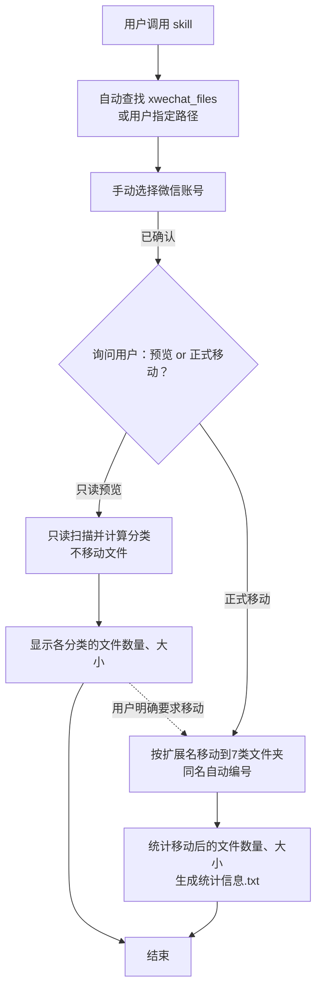

# wechat_download_files_organizer

一个非常小的skill,  用于整理 Windows 的微信APP下载的文件。

1. 在当前 Windows 用户目录和 Windows 文档目录下查找 `xwechat_files\<账号文件夹>\msg\file`，汇总找到的账号；也可直接指定文件目录
2. 如果电脑里登陆过多个微信, Agent会先询问要操作哪个微信号
3. Agent会先询问用户, 是进行预览, 还是进行移动操作. 预览显示各分类的文件数量、大小和总计，大小自动选择 KB、MB 或 GB。
4. 如果用户确定移动, 则把微信下载的文件, 移动到\msg\file\整理归纳,  其中 "整理归纳"文件夹是本skill新增的, 里面包含 `word`、`excel`、`ppt`、`压缩包`、`DWG`、`PDF`、`其他`这7个文件夹. 同名文件会自动编号(后面新增数字).
5.  生成包含文件数量与大小的.txt 统计报告。

> 注意, 当执行本skill后, 由于文件移动了位置, 则在微信聊天窗口中点击别人发的文件时, 不像往常一样直接打开文件. 而是提示未下载, 需要重新下载.

## 工作流程



选择预览后不会自动转为移动；图中的虚线仅表示用户后续明确要求移动时的流程。操作选择由 agent 询问，脚本本身不弹出确认。

## 安装到 Codex 或 Claude Code

1. 从本仓库下载 ZIP 并解压，或使用 Git 克隆仓库。
2. 将包含 `SKILL.md` 的整个文件夹命名为 `wechat_download_files_organizer`。
3. 把同一个完整文件夹复制到所用工具的用户技能目录（若已有同名版本，先备份）：

| 工具 | 安装目录 | 显式调用 |
| --- | --- | --- |
| Codex | `%USERPROFILE%\.agents\skills\wechat_download_files_organizer\` | `$wechat_download_files_organizer` |
| Claude Code | `%USERPROFILE%\.claude\skills\wechat_download_files_organizer\` | `/wechat_download_files_organizer` |

同时使用两个工具时，分别复制一份；两边使用完全相同的脚本和规则。目录不存在时先创建，不要多套一层同名文件夹。

安装位置参考：[Codex 官方说明](https://developers.openai.com/codex/build-skills)、[Claude Code 官方说明](https://code.claude.com/docs/en/skills)。

安装后的结构应为：

```text
%USERPROFILE%\.agents\skills\
└── wechat_download_files_organizer\
    ├── README.md
    ├── SKILL.md
    ├── agents\
    │   └── openai.yaml
    ├── scripts\
    │   └── organize.ps1
    └── tests\
        └── test_organizer.py
```

如果工具没有显示新安装或更新的 skill，请重新启动对应工具或新建会话。

## 在 Claude Code 中使用(尚未测试)

输入 `/wechat_download_files_organizer`，或附上“预览微信文件，先不要移动文件”。未指定目录时，会先列出候选账号并等待选择；目录确定后，再询问本次进行只读预览还是正式移动。

如果提示需要权限, 则回复同意Claude Code的需求.

## 在 Codex 中使用(成功测试)

此 skill 当前配置为显式调用，请在对话框中按$符号, 主动调用 `$wechat_download_files_organizer`。

### 预览分类

```text
使用 $wechat_download_files_organizer 预览微信下载文件的分类情况，先不要移动文件。
```

### 正式整理

```text
使用 $wechat_download_files_organizer 整理我的微信下载文件，并生成统计报告。
```

未指定目录时，Codex 会列出找到的账号文件夹及完整路径，等待你选择；只有一个候选账号时也会询问。选择后，同一次任务内使用该目录，不批量处理其他账号。

也可以在请求中直接给出要整理的 `msg\file` 完整路径。微信文件保存在自定义位置时，请提供实际路径。

账号或目录确定后，agent 会再次询问：

> 本次要进行“只读预览”（不移动、不写报告），还是“正式移动”（分类移动并更新统计报告）？

即使最初说了“整理”，或直接给出完整路径，也会等待这次操作选择。选择预览后只汇报预览结果，不自动接着移动；之后明确要求移动同一目录时才执行。尚未回答或取消时，不运行预览或移动。安装或修改 skill 本身不会触发整理。

## 直接运行脚本

以下命令均在本仓库根目录（即 `SKILL.md` 所在目录）执行。先将路径占位符替换为本机实际目录。上述交互确认由 agent 负责；直接在终端运行脚本时，仍由 `-Apply` 决定是否移动，脚本不额外弹出询问。

### 1. 列出候选账号

```powershell
powershell.exe -NoProfile -NonInteractive -File "./scripts/organize.ps1" -ListAccounts -AsJson
```

默认检查以下两个位置，并汇总其中的账号：

- 当前 Windows 用户目录下的 `xwechat_files`，例如 `C:\Users\用户名\xwechat_files`。
- Windows 文档目录下的 `xwechat_files`，例如 `C:\Users\用户名\Documents\xwechat_files`；文档目录被重定向时使用系统返回的实际位置。

两处路径相同时只检查一次。两处都有同名账号时保留各自完整路径供用户选择；只有一个候选也须确认。找不到账号时询问实际路径，不全盘搜索。发现阶段仅检查 `<账号文件夹>\msg\file` 结构，不遍历账号中的文件。

JSON 的 `SearchRoots` 列出本次检查的根目录；兼容字段 `SearchRoot` 在只有一个搜索根目录时返回该路径，多个时为 `null`。

指定其他 `xwechat_files` 位置（只检查指定位置，不再检查两个默认位置）：

```powershell
powershell.exe -NoProfile -NonInteractive -File "./scripts/organize.ps1" -ListAccounts -WechatBasePath "<xwechat_files 的完整路径>" -AsJson
```

### 2. 只读预览

```powershell
powershell.exe -NoProfile -NonInteractive -File "./scripts/organize.ps1" -RootPath "<选定的 msg\file 完整路径>" -AsJson
```

预览不会移动文件，也不会创建分类目录或统计报告。结果显示七个分类的文件数量、文件大小及总计；大小仅包含本次待整理文件，不含 `整理归纳` 中已有文件。

各分类和总计分别按真实字节数自动选择 KB、MB 或 GB，按 1024 换算并保留两位小数；空分类显示 `0.00 KB`。总计先累加原始字节数再换算。以下为预览示例：

| 分类 | 文件数量 | 文件大小 |
| --- | ---: | ---: |
| word | 2 | 768.00 KB |
| excel | 1 | 768.00 KB |
| ppt | 0 | 0.00 KB |
| 压缩包 | 0 | 0.00 KB |
| DWG | 0 | 0.00 KB |
| PDF | 0 | 0.00 KB |
| 其他 | 0 | 0.00 KB |
| 总计 | 3 | 1.50 MB |

JSON 的 `Statistics` 返回各分类的 `Folder`、`FileCount`、`Size` 和兼容字段 `SizeKB`，`TotalFiles`、`TotalSize` 返回总计。读取失败时 `StatisticsComplete=false`，必须说明预览统计不完整。

### 3. 正式整理

```powershell
powershell.exe -NoProfile -NonInteractive -File "./scripts/organize.ps1" -RootPath "<选定的 msg\file 完整路径>" -Apply -AsJson
```

`-AsJson` 可省略，省略后输出可读文本。`-ListAccounts` 不能与 `-RootPath` 或 `-Apply` 同时使用；`-WechatBasePath` 仅用于列出账号。预览和正式整理都必须明确提供 `-RootPath`。

### 4. 按需查看逐文件明细

默认 JSON 返回分类数量、重命名数、失败详情、跳过链接、统计及报告位置，不包含 `Records`。默认文本也只输出汇总、失败和跳过链接情况。

预览完整明细：

```powershell
powershell.exe -NoProfile -NonInteractive -File "./scripts/organize.ps1" -RootPath "<选定的 msg\file 完整路径>" -AsJson -IncludeRecords
```

正式整理并返回完整明细：

```powershell
powershell.exe -NoProfile -NonInteractive -File "./scripts/organize.ps1" -RootPath "<选定的 msg\file 完整路径>" -Apply -AsJson -IncludeRecords
```

`-IncludeRecords` 使 JSON 增加 `Records` 数组；可读文本则逐条显示状态、源路径和目标路径。它只控制输出，不改变分类、移动或统计行为，失败原因始终返回。依赖旧版 `Records` 字段的调用方须添加此参数；不生成额外日志文件。

## 文件分类

按扩展名匹配，忽略大小写，不解压文件，不修改文件内容。

| 分类目录 | 扩展名 |
| --- | --- |
| `word` | `.doc` `.docx` `.docm` `.dot` `.dotx` `.dotm` `.wps` `.wpt` |
| `excel` | `.xls` `.xlsx` `.xlsm` `.xlsb` `.xlt` `.xltx` `.xltm` `.csv` `.et` `.ett` |
| `ppt` | `.ppt` `.pptx` `.pptm` `.pot` `.potx` `.potm` `.pps` `.ppsx` `.ppsm` `.dps` `.dpt` |
| `压缩包` | `.zip` `.rar` `.7z` `.tar` `.gz` `.tgz` `.bz2` `.xz` `.zst` `.cab` |
| `DWG` | `.dwg` |
| `PDF` | `.pdf`（忽略扩展名大小写） |
| `其他` | 其余文件，包括图片、YML 和无扩展名文件 |

## 整理结果与统计报告

文件移动到本次选定源目录下的 `整理归纳`：

```text
msg/file/
└── 整理归纳/
    ├── word/
    ├── excel/
    ├── ppt/
    ├── 压缩包/
    ├── DWG/
    ├── PDF/
    ├── 其他/
    └── 整理统计.txt
```

每次正式运行都会覆盖更新 UTF-8 编码的 `整理统计.txt`，即使本次没有文件需要移动。再次整理时会跳过整个 `整理归纳` 目录，避免重复移动已归类文件。

统计范围为 `整理归纳` 下所有直接子文件夹中的递归文件，包含已有文件及用户新增目录；空目录显示零，链接跳过。各文件夹和总计分别自动选择大小单位：小于 1 MB 显示 KB，达到 1 MB 且小于 1 GB 显示 MB，达到 1 GB 显示 GB。按 **1 KB = 1024 字节、1 MB = 1024 KB、1 GB = 1024 MB** 换算，保留两位小数，使用文件逻辑大小；空目录显示 `0.00 KB`。总计基于原始字节数独立计算和换算。`整理归纳` 根目录中的文件不计入总计。

JSON 的 `Statistics[].Size` 为带单位的大小（如 `1.50 GB`），同时保留原有 `SizeKB` 字段；`TotalFiles`、`TotalSize` 返回总计。正式整理的这些字段统计目标目录中的实际文件，包含已有文件；预览时则仅统计本次待整理文件。

报告保留三列表格，根据中英文显示宽度及实际内容自动调整列宽。文件夹名称左对齐，数量和大小右对齐，用 ` | ` 分隔，分隔线与表格同宽。

**查看时请使用等宽字体，例如新宋体（NSimSun）。** TXT 文件本身不能指定字体，使用比例字体时空格无法保证列对齐。可在记事本的字体设置中更换字体；长目录名导致折行时，关闭自动换行或加宽窗口。

下面为报告格式示例，时间和数据仅作演示：

```text
微信文件整理统计
=========================================
统计时间：2026-10-21 15:30:00（北京时间）

文件夹            | 文件数量 |   文件大小
------------------+----------+-----------
word              |    12 个 |   18.00 MB
excel             |     8 个 |    6.00 MB
ppt               |     5 个 |   45.00 MB
压缩包            |     4 个 |  120.00 MB
DWG               |     7 个 |   32.00 MB
PDF               |    10 个 |   20.00 MB
其他              |     5 个 |    4.00 MB
------------------+----------+-----------
总计              |    51 个 |  245.00 MB

说明：
统计包含子文件夹中的文件。
本报告不计入统计。
建议使用等宽字体（如新宋体）查看本表。
=========================================
```

本次运行不生成移动记录 CSV，也不删除已有历史 CSV；普通 CSV 文件仍归入 `excel` 并计入统计。

若目录读取失败，报告会标注统计不完整。请检查运行结果中的失败信息；JSON 结果的 `Success=false` 表示存在失败，报告写入失败也会在结果中反映。

## 使用前须知

- 正式整理会实际移动文件。移动后，微信原聊天记录中的文件入口可能无法按原路径打开，可从 `整理归纳` 中打开文件。
- 分类后不保留原有月份或子目录层级。需要保留原始结构时，请先自行备份。
- 文件被其他程序占用或权限不足时可能移动失败，请检查结果后再处理。

## 环境要求

| 环境         | 要求                                                         |
| ------------ | ------------------------------------------------------------ |
| 操作系统     | Windows                                                      |
| 执行环境     | Windows 自带的 Windows PowerShell 5.1，或 PowerShell 7；无需额外安装 7 |
| AI 工具      | Windows 本机的 Codex 或 Claude Code；直接运行脚本不需要 AI 工具 |
| 脚本执行策略 | 必须允许该脚本执行；Windows 客户端默认 Restricted 会阻止 `.ps1`，见下方处理说明 |
| 文件权限     | 预览需要读取权限；正式整理需要源目录及目标目录的相应读写权限 |
| Python       | 仅运行测试时需要 Python 3，日常整理不需要                    |

可以通过以下命令检查 PowerShell 版本：

```powershell
powershell.exe -NoProfile -Command '$PSVersionTable.PSVersion'
```

脚本通过本地文件系统操作文件，不需要微信登录接口或 API 密钥。

Windows 11 自带的是 Windows PowerShell 5.1（`powershell.exe`），PowerShell 7（`pwsh.exe`）需另外安装，二者可并存，见 [Microsoft 官方说明](https://learn.microsoft.com/en-us/powershell/scripting/install/install-powershell-on-windows)。本包兼容两者，不依赖某个 AI 工具附带的私有运行时。

保留 `scripts/organize.ps1` 的 UTF-8 BOM；不要另存为无 BOM 的 UTF-8 或 ANSI。脚本的控制台输出和统计报告均显式使用 UTF-8。默认调用不修改或覆盖 PowerShell 执行策略。运行时兼容与脚本执行权限是独立的前提。

## 项目文件

| 文件 | 用途 |
| --- | --- |
| [SKILL.md](SKILL.md) | Codex 的调用流程、分类规则和输出要求 |
| [agents/openai.yaml](agents/openai.yaml) | 显示信息和显式调用配置 |
| [scripts/organize.ps1](scripts/organize.ps1) | 账号发现、只读预览、文件移动与统计实现 |
| [tests/test_organizer.py](tests/test_organizer.py) | 基于临时文件的集成测试 |

## 运行测试

测试需要 Windows 和 Python 3（日常使用不需要 Python）。默认使用系统自带的 PowerShell 5.1，且要求已有策略允许执行本地脚本。测试不改变策略，在仓库根目录运行：

```powershell
python ./tests/test_organizer.py
```

要验证 PowerShell 7，在 PowerShell 中先设 `$env:WECHAT_TEST_POWERSHELL = "pwsh"` 再运行相同测试；也可指定可执行文件的完整路径。测试脚本按 UTF-8 读取输出。

测试使用独立临时目录，不操作真实微信下载目录。临时目录创建在仓库的父目录下，因此该位置需要写入权限；涉及文件符号链接的测试在缺少相应 Windows 权限时会跳过。

## 执行策略与自动模式权限

Windows 自带 PowerShell 5.1，并不代表默认允许执行 `.ps1`。所有作用域均为 `Undefined` 时，Windows 客户端的有效策略为 `Restricted`，仍会禁止运行脚本。默认示例遵守现有策略，不自动附加 `-ExecutionPolicy Bypass`。

若出现 `UnauthorizedAccess`、`PSSecurityException` 或“禁止运行脚本”，先在 PowerShell 或 Git Bash 中只读检查：

```text
powershell.exe -NoProfile -NonInteractive -Command 'Get-ExecutionPolicy -List; Get-ExecutionPolicy'
```

普通的“整理微信文件”请求不授权调整执行策略。若这是你自行管理的电脑，在理解并选择后，可由你手动配置当前用户：

```powershell
Set-ExecutionPolicy -Scope CurrentUser -ExecutionPolicy RemoteSigned
```

这会持久影响当前用户，允许本地未签名脚本运行；带有 Internet 来源标记的脚本需要可信签名。此命令不是 skill 自动执行的步骤。原作用域为 `Undefined` 时，如需恢复可由你运行 `Set-ExecutionPolicy -Scope CurrentUser -ExecutionPolicy Undefined`；若原值不同，应恢复原值。已有组织策略时遵守管理员规定。

也可以明确授权仅某个 PowerShell 进程使用 `RemoteSigned`，而不持久修改当前用户；取得这项授权后才可为该进程添加 `-ExecutionPolicy RemoteSigned`。两种范围不能互相代替授权。

从浏览器下载的 ZIP 或脚本可能带 Internet 来源标记；即使使用 `RemoteSigned`，也不能承诺任何下载来源都可直接运行。遇到签名或来源限制时，检查来源和组织要求，不自动解除阻止。

Claude 自动模式检查无结果或拒绝时，明确报告受限动作和原因，不延时或改写命令反复重试，也不放宽工具权限；执行策略调整需对应授权。脚本被系统阻止时，脚本内的 UTF-8 输出设置尚未运行，因此错误中文可能乱码；`UnauthorizedAccess` 仍可用于辨认失败类型。

官方参考：[Microsoft 执行策略](https://learn.microsoft.com/en-us/powershell/module/microsoft.powershell.core/about/about_execution_policies?view=powershell-5.1)、[Claude 自动模式](https://code.claude.com/docs/s/claude-code-auto-mode)。
